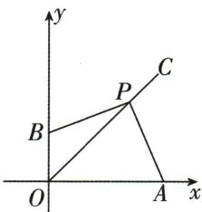

<!-- question-source:start -->
10 如图, 已知点 $P(2m - 1, 6m - 5)$ 在第一象限角平分线 $OC$ 上, 一直角顶点与点 $P$ 重合, 角的两边与 $x$ 轴、 $y$ 轴分别交于 $A$ 点, $B$ 点, 则: (1) 点 $P$ 的坐标为 \_\_\_\_; (2) $OA + BO =$ \_\_\_\_.

<!-- question-source:end -->

![[Q00104199A1]]
