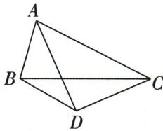

<!-- question-source:start -->
11[2024 福建福州期中]如图, $\triangle ABC$ 中, $BC = 10, AC - AB = 5, AD$ 是 $\angle BAC$ 的平分线, $CD \perp AD$ , 则 $S_{\triangle BDC}$ 的最大值为 \_\_\_\_.

<!-- question-source:end -->

![[Q00104200A1]]
