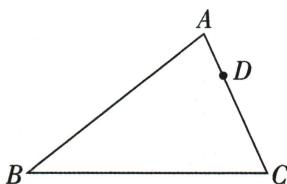

<!-- question-source:start -->
12[2025 河北秦皇岛期中]如图,在 $\triangle ABC$ 中, $D$ 是 $AC$ 上一点( $CD>AD$ )。
(1)连接 $BD$ ,作 $\triangle DEF$ (点 $E$ 在线段 $CD$ 上,点 $F$ 在线段 $AC$ 的右侧),使得 $\triangle DEF \cong \triangle DAB$ ; (保留作图痕迹,不写作法)
(2)作图依据是\_\_\_\_.

<!-- question-source:end -->

![[Q00104201A1]]
