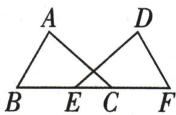
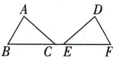
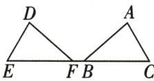

<!-- question-source:start -->
13 如图, $\triangle ABC$ 和 $\triangle DEF$ , 点 $E, F$ 在直线 $BC$ 上, $AB = DF$ , $\angle A = \angle D$ , $\angle ABC = \angle DFE$ . 如图 (1), 易证: $BC + BE = BF$ . 请解答下列问题: (1) 如图 (2)、图 (3), 请猜想 $BC, BE, BF$ 之间的数量关系,并直接写出猜想结论;

(2)请选择(1)中任意一种结论进行证明.

图(1)

图(2)

图(3)

<!-- question-source:end -->

![[Q00104202A1]]
