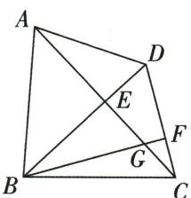
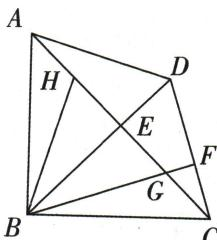

<!-- question-source:start -->
14 已知在四边形 ABCD 中, 对角线 AC, BD 相交于点 E, 且 $AC \perp BD$ , 作 $BF \perp CD$ , 垂足为 F, BF 与 AC 交于点 G, $\angle BGE = \angle ADE$ .
(1) 如图(1), 求证: AD = CD;
(2) 如图(2), BH 是 $\triangle ABE$ 的中线, 若 AE = 2DE, DE = EG, 在不添加任何辅助线的情况下, 请直接写出图(2)中四个三角形, 使写出的每个三角形的面积都等于 $\triangle ADE$ 面积的 2 倍.

图(1)

图(2)
<!-- question-source:end -->

![[Q00104203A1]]
