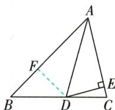

> [!success]- 必刷题
>
> > [!success] **【答案】** B
>
> > [!note]- **【解析】**
> > 过 D 作 $DF \perp AB$ 于 F，如图. ∵ AD 平分 $\angle BAC, DE \perp AC, DF \perp AB, \therefore DE = DF.$ ∵ $\triangle ABD$ 的面积为 5, ∴ $\frac{1}{2}AB \cdot DF = 5.$
> >
> > 
> >
> > ∵ AB=5, ∴ DF=2, ∴ DE=2. 故选 B.
> >
> > 6.6 【解析】由作图可知 BP 平分 $\angle ABC$ . ∵ AD 是边 BC 上的高, $MN \perp AB$ , MN = 2, ∴ MD = MN = 2. ∵ AD = 4MD, ∴ AD = 8, ∴ AM = AD - MD = 6, 故答案为 6.
