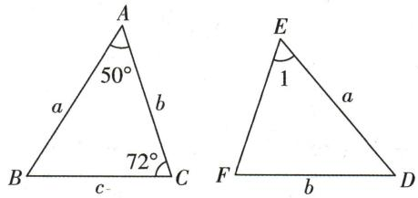

> [!success]- 必刷题
>
> > [!success] **【答案】** B
>
> > [!note]- **【解析】**
> > 如图, ∵ △ABC 和 △DEF 全等,
> > AC = DF = b, DE = AB = a, ∴ ∠1 = ∠B, ∠A =
> > ∠D = 50°, ∠F = ∠C = 72°, ∴ ∠1 = 180° -
> > ∠D - ∠F = 58°, 故选 B.
> >
> > 
