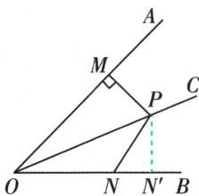
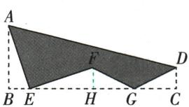

> [!success]- 必刷题
>
> > [!success] **【答案】** A
>
> > [!note]- **【解析】**
> > 如图, 过点 P 作 $PN' \perp OB$ , 交 OB▶思路分析
> >
> > 于 $N'$ . ∵ OP 平分 $\angle AOB, PM \perp OA, PN' \perp OB$ ,
> >
> > ∴ $PN' = PM = 6$ . 由垂线段最短可知满足 PN = 6 的点 N 有 1 个, 即点 $N'$ . 故选 A.
> >
> > 
> >
> > B▶思路分析
> > , 过点 P 作
> > = PN' ⊥ OB, 交
> > OB 于 N', 根
> > 据角平分线的
> > 性质求出
> > PN', 再根据
> > 垂线段最短解
> > 答即可.
> >
> > 
> > (第4题图)
> > (第5题图)
