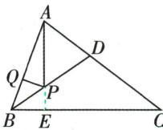

> [!success]- 必刷题
>
> > [!success] **【答案】** A
>
> > [!note]- **【解析】**
> > 在 BC 上截取 BE = BQ，连接 PE，如图。∵ BD 平分 ∠ABC，∴ ∠ABD = ∠CBD = $\frac{1}{2}$ ∠ABC = 35°。又∵ BP = BP，BQ = BE，
> >
> > $\therefore \triangle PBQ \cong \triangle PBE(SAS), \therefore PE = PQ, \therefore AP + PQ = AP + PE, \therefore$ 当 $A, P, E$ 在同一直线上，且 $AE \perp BC$ 时， $AP +$
> >
> > 
> >
> > PE 的值最小，即 $AP + PQ$ 的值最小.
> > ∵ $\angle AEB = 90^{\circ}$ , $\angle ABE = 70^{\circ}$ , ∴ $\angle BAE = 90^{\circ} - \angle ABE = 20^{\circ}$ , ∴ $\angle APD = \angle BAP + \angle ABP = 20^{\circ} + 35^{\circ} = 55^{\circ}$ ,
> >
> > 故选 **A**.
