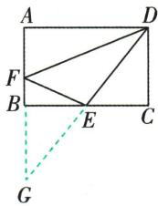

> [!success]- 必刷题
>
> > [!success] **【答案】** A
>
> > [!note]- **【解析】**
> > 如图,延长 DE,AB 交于点 G. ∵ 在长方形 ABCD 中, AB // CD, AB = CD, ∴ ∠GBE = ∠C. 在 △BEG 和
> > △CED 中, $\left\{\begin{aligned}\angle GBE&=\angle C,\\BE&=CE,\\ \angle BEG&=\angle CED,\end{aligned}\right.$
> >
> > 
> >
> > $\therefore \triangle BEG \cong \triangle CED (\mathrm{ASA}), \therefore DE = GE, BG = CD = AB, \therefore S_{\triangle EGF} = S_{\triangle DEF} = 10. \because 5S_{\triangle BEF} = 10,$ $\therefore S_{\triangle BEF} = 2, \therefore S_{\triangle BEG} = S_{\triangle FEG} - S_{\triangle BEF} = 8, \therefore \frac{BG}{BF} =$ $\frac{S_{\triangle BEG}}{S_{\triangle BEF}} = 4, \therefore \frac{AB}{BF} = \frac{BG}{BF} = 4,$
> >
> > 故选 **A**.
