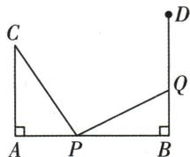

> [!success]- 必刷题
>
> > [!success] **【答案】** B
>
> > [!note]- **【解析】**
> > 若 x=1，运动时间为 t 秒，则点 P 运动路程为 2t，点 Q 运动路程为 t，故点 P 运动路程始终是点 Q 运动路程的 2 倍，故①正确，符合题意。点 P 到达点 A 的运动时间为 $6 \div 2 = 3$ （秒），当 x=5 时，点 Q 到达点 A 的运动时间为 $(8+10) \div 5 = 3.6$ （秒）， $3.6 \neq 3$ ，故②不
> >
> > 正确,不符合题意.如图所示,当 t=5,x=1 时,点 P 运动的路程为 $2 \times 5 = 10$ , 点 Q 运动的路程为 $5 \times 1 = 5$ .
> > ∵ AC = 6, DQ = 5, BD = 8,
> >
> > 
> >
> > $\therefore AP = 10 - 6 = 4, BQ = BD - DQ = 8 - 5 = 3.$ $\because AB = 10, \therefore PB = AB - AP = 10 - 4 = 6, \therefore PB = CA.$ 又 $\because \angle CAP = \angle PBQ = 90^{\circ}, AP \neq BQ,$ $\therefore \triangle CAP$ 和 $\triangle PBQ$ 不全等， $\therefore \angle C \neq \angle QPB.$ $\because \angle C + \angle CPA = 90^{\circ}, \therefore \angle QPB + \angle CPA \neq 90^{\circ},$ $\therefore \angle CPQ = 180^{\circ} - (\angle QPB + \angle CPA) \neq 90^{\circ},$ $\therefore PC$ 与 $PQ$ 不垂直，故③不正确，不符合题意. 当点 $P$ 在 $AB$ 上，且点 $Q$ 在 $BD$ 上时， $AP = 2t - 6, QD = xt$ ，则 $PB = 10 - (2t - 6) = 16 - 2t, BQ = 8 - xt.$ 若 $\triangle ACP$ 与 $\triangle BPQ$ 全等，则 $AC = PB$ 且 $AP = BQ$ 或 $AC = BQ$ 且 $AP = BP$ ，即 $6 = 16 - 2t$ 且 $2t - 6 = 8 - xt$ 或 $6 = 8 - xt$ 且 $2t - 6 = 16 - 2t$ ，解得 $x = \frac{4}{5}$ 或 $\frac{4}{11}$ ，故④正确，符合题意，
> >
> > 故选 **B**.
