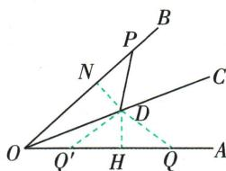

> [!success]- 必刷题
>
> > [!success] **【答案】** $36^{\circ}$ 或 $144^{\circ}$
>
> > [!note]- **【解析】**
> > 如图, 过点 D 作 $DH \perp OA$ 于 H, $DN \perp OB$ 于 N.
> >
> > ∵ OD 平分 ∠AOB, $O^{4}$ $DH \perp OA, DN \perp OB, \therefore DH = D$
> >
> > 
> >
> > $DH \perp OA, DN \perp OB, \therefore DH = DN.$ 当点 $Q$ 在点 $H$
> >
> > 的右侧时, 在 Rt $\triangle DPN$ 和 Rt $\triangle DQH$ 中, $\left\{ \begin{array}{l} DP = DQ, \\ DN = DH, \end{array} \right.$ $\therefore \mathrm{Rt}\triangle DPN \cong \mathrm{Rt}\triangle DQH (\mathrm{HL}),$ $\therefore \angle DPO = \angle DQO = 36^{\circ}$ . 当点 $Q$ 在点 $H$ 左侧时, 如点 $Q'$ , 同理可得 $\angle DQ'H = 36^{\circ}, \therefore \angle DQ'O = 144^{\circ}$ . 综上所述, $\angle DQO$ 的度数为 $36^{\circ}$ 或 $144^{\circ}$ , 故答案为 $36^{\circ}$ 或 $144^{\circ}$ .
