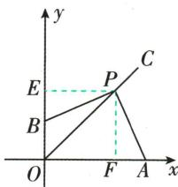
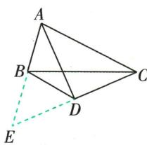

> [!success]- 必刷题
>
> > [!success] **【答案】** (1) (1, 1) (2) 2
>
> > [!note]- **【解析】**
> > (1) 如图, 作 ▶2m - 1 = 6m -
> >
> > $PE \perp y$ 轴于点 $E, PF \perp x$ 轴于点 $F$ . 根据题意, 得 $PE = PF, \therefore 2m - 1 = 6m - 5$ , 解得 $m = 1, \therefore P(1, 1)$ . (2) 由 (1) 得 $\angle EPF = 90^\circ$ ,
> >
> > 
> >
> > 思路分析
> > (1) 作 $PE \perp y$ 轴于 E, $PF \perp x$ 轴于 F. 由角平分线的性质得出 PE = PF，进而得出方程 2m - 1 = 6m -
> >
> > $PE = PF = 1.\because \angle BPA = 90^{\circ},\therefore \angle EPB =$ $\angle FPA.$ 在 $\triangle BEP$ 和 $\triangle AFP$ 中， $\left\{ \begin{array}{ll}\angle PEB = \angle PFA,\\ PE = PF,\quad \therefore \triangle BEP\cong \triangle AFP(ASA),\\ \angle EPB = \angle FPA, \end{array} \right.$ $\therefore BE = AF,\therefore OA + OB = OF + AF + OE - BE =$ $OF + OE,\therefore OA + BO = 2.$
> >
> > 5, 解方程求出 m=1，即可得出 P 点坐标；
> > (2) 由 ASA 证明 $\triangle BEP \cong \triangle AFP$ ，得出 BE = AF，则 $OA + OB = OE + OF = 2.$
> >
> > 
