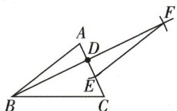

> [!success]- 必刷题
>
> > [!success] **【答案】** SAS(答案不唯一,与(1)的作图痕迹对应即可)
>
> > [!note]- **【解析】**
> > 【解】(1)如图, $\triangle DEF$ 即为所求.
> >
> > 
> >
> > (2) 在 $\triangle DEF$ 和 $\triangle DAB$ 中, $\left\{ \begin{array}{l} DE = DA, \\ \angle EDF = \angle ADB, \\ DF = DB, \end{array} \right.$
> >
> > ∴ $\triangle DEF \cong \triangle DAB(\text{SAS})$ . 故答案为 SAS(答案不唯一,与(1)的作图痕迹对应即可).
