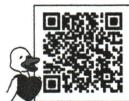
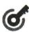

## 全章综合训练 刷章测

![[初中/课堂同步/教辅/必刷题/2026版《初中必刷题》数学 RJ  8上/14_第十四章_全等三角形/全章综合训练/questions/Q00104190.md]]
![[初中/课堂同步/教辅/必刷题/2026版《初中必刷题》数学 RJ  8上/14_第十四章_全等三角形/全章综合训练/questions/Q00104191.md]]
![[初中/课堂同步/教辅/必刷题/2026版《初中必刷题》数学 RJ  8上/14_第十四章_全等三角形/全章综合训练/questions/Q00104192.md]]
![[初中/课堂同步/教辅/必刷题/2026版《初中必刷题》数学 RJ  8上/14_第十四章_全等三角形/全章综合训练/questions/Q00104193.md]]
![[初中/课堂同步/教辅/必刷题/2026版《初中必刷题》数学 RJ  8上/14_第十四章_全等三角形/全章综合训练/questions/Q00104194.md]]
![[初中/课堂同步/教辅/必刷题/2026版《初中必刷题》数学 RJ  8上/14_第十四章_全等三角形/全章综合训练/questions/Q00104195.md]]
![[初中/课堂同步/教辅/必刷题/2026版《初中必刷题》数学 RJ  8上/14_第十四章_全等三角形/全章综合训练/questions/Q00104196.md]]
![[初中/课堂同步/教辅/必刷题/2026版《初中必刷题》数学 RJ  8上/14_第十四章_全等三角形/全章综合训练/questions/Q00104197.md]]

## 二、填空题(本大题共3小题,每小题5分,共15分)

![[初中/课堂同步/教辅/必刷题/2026版《初中必刷题》数学 RJ  8上/14_第十四章_全等三角形/全章综合训练/questions/Q00104198.md]]
![[初中/课堂同步/教辅/必刷题/2026版《初中必刷题》数学 RJ  8上/14_第十四章_全等三角形/全章综合训练/questions/Q00104199.md]]
![[初中/课堂同步/教辅/必刷题/2026版《初中必刷题》数学 RJ  8上/14_第十四章_全等三角形/全章综合训练/questions/Q00104200.md]]

## 三、解答题(本大题共3小题,共45分)

![[初中/课堂同步/教辅/必刷题/2026版《初中必刷题》数学 RJ  8上/14_第十四章_全等三角形/全章综合训练/questions/Q00104201.md]]
![[初中/课堂同步/教辅/必刷题/2026版《初中必刷题》数学 RJ  8上/14_第十四章_全等三角形/全章综合训练/questions/Q00104202.md]]
![[初中/课堂同步/教辅/必刷题/2026版《初中必刷题》数学 RJ  8上/14_第十四章_全等三角形/全章综合训练/questions/Q00104203.md]]

# 15.1 图形的轴对称

# 15.1.1 轴对称及其性质

电子错题本鸭

基础
建议用时 15 分钟 答案 D35

## 知识点 1 轴对称图形

