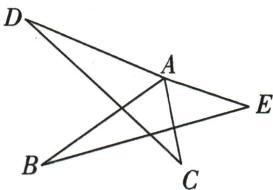

<!-- question-source:start -->
3[2024 江苏淮安调研, 中]如图, 已知 AD = AB, AC = AE, $\angle DAB = \angle CAE$ , 连接 DC, BE.

(1)试说明: $\triangle BAE\cong\triangle DAC.$

(2) 若 $\angle CAD = 125^{\circ}, \angle D = 20^{\circ}$ , 求 $\angle E$ 的度数.

<!-- question-source:end -->

![[Q00104154A1]]
