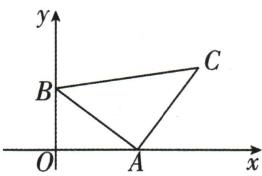

<!-- question-source:start -->
5[2024 广东广州期中, 中]已知在平面直角坐标系中, $A(4,0)$ , $B(0,3)$ , 以线段 AB 为直角边在第一象限内作等腰直角三角形 ABC, AB = AC, $\angle BAC = 90^{\circ}$ , 如图.

(1)求出 $OA \cdot OB$ 的值.

(2)求点 $C$ 坐标.

<!-- question-source:end -->

![[Q00104156A1]]
