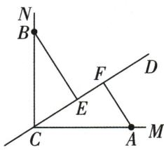
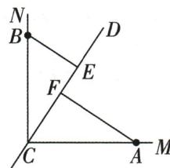
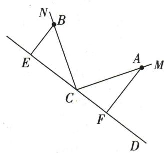

<!-- question-source:start -->
6[2025 湖北天门期中,较难]已知 $CD$ 是经过 $\angle NCM$ 的顶点 $C$ 的一条直线, $A,B$ 分别在 $CM$ , $CN$ 上, 且 $CA=CB,E,F$ 是直线 $CD$ 上两点, 且 $\angle BEC=\angle CFA=\angle \alpha$ .

(1) 若直线 $CD$ 经过 $\angle BCA$ 的内部, 且 $E,F$ 在射线 $CD$ 上, 请解决下面的问题:

①如图(1), 若 $\angle BCA=90^{\circ}, \angle \alpha=90^{\circ}$ , 请探索三条线段 $EF,BE,AF$ 之间的数量关系, 并证明你的结论.

②如图(2), 若 $0^{\circ}<\angle BCA<180^{\circ}$ , 请添加一个关于 $\angle \alpha$ 与 $\angle BCA$ 关系的条件: \_\_\_\_, 使①中的结论仍然成立.

(2) 如图(3), 若直线 $CD$ 经过 $\angle BCA$ 的外部, $E$ 在 $F$ 的左侧, $\angle \alpha=\angle BCA$ , 请写出三条线段 $EF$ , $BE,AF$ 之间的数量关系, 并证明你的结论.

图(1)

图(2)

图(3)
<!-- question-source:end -->

![[Q00104157A1]]
