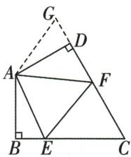
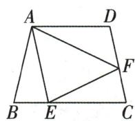
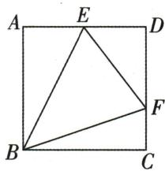

<!-- question-source:start -->
7[中]【问题背景】如图(1)，在四边形ABCD中， $AB = AD, \angle BAD = 120^{\circ}, \angle B = \angle ADC = 90^{\circ}, E, F$ 分别是BC, CD上的点，且 $\angle EAF = 60^{\circ}$ ，试探究图中线段BE, EF, DF之间的数量关系. (1)小王同学探究此问题的方法如下：延长FD到点G，使 $DG = BE$ ，连接AG，先说明 $\triangle ABE \cong \triangle ADG$ ，再说明 $\triangle AEF \cong \triangle AGF$ ，可得出结论，他的结论应是\_\_\_\_. 【探索延伸】(2)如图(2)，若在四边形ABCD中， $AB = AD, \angle B + \angle D = 180^{\circ}, E, F$ 分别是BC，CD上的点，且 $\angle EAF = \frac{1}{2} \angle BAD$ ，则上述结论是否仍然成立？请说明理由. 【学以致用】(3)如图(3)，四边形ABCD是边长为5的正方形， $\angle EBF = 45^{\circ}$ ，请直接写出 $\triangle DEF$ 的周长.

图(1)

图(2)

图(3)

建议用时 30 分钟 答案 D27
<!-- question-source:end -->

![[Q00104158A1]]
