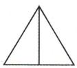

> [!success]- 必刷题
>
> > [!success] **【答案】** 详见解析
>
> > [!note]- **【解析】**
> > 【解】因为 $AC \parallel DF, BC \parallel EF$ ，所以 $\angle A = \angle EDF, \angle ABC = \angle E.$ 又因为 AC = DF，所以 $\triangle ABC \cong \triangle DEF$ （AAS），所以 AB = DE，所以 $AB - BD = DE - BD$ ，所以 AD = BE.
> >
> > ## 大招解读 | 对称模型
> >
> > 将两个三角形沿着某一条直线折叠后, 直线两边的三角形能够完全重合, 这两个三角形称为对称型全等三角形, 此类图形中要注意隐含条件, 即公共边或公共角相等.
> >
> > <table><tr><td>基本模型</td><td>常见模型</td></tr><tr><td></td><td></td></tr></table>
