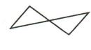
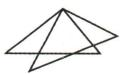
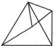
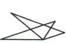
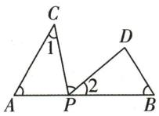
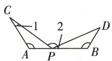
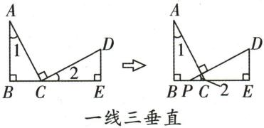

> [!success]- 必刷题
>
> > [!success] **【答案】** 详见解析
>
> > [!note]- **【解析】**
> > 【解】因为 $\angle BAD = \angle EAC$ ，所以 $\angle BAD + \angle CAD = \angle EAC + \angle CAD$ ，即 $\angle BAC = \angle EAD$ 。
> > 在 $\triangle BAC$ 与 $\triangle EAD$ 中， $\left\{\begin{aligned}AB&=AE,\\ \angle BAC&=\angle EAD,\\ AC&=AD,\end{aligned}\right.$ $\triangle BAC \cong \triangle EAD(SAS)$ ，所以 $\angle D = \angle C = 50^{\circ}$ .
> >
> > 将三角形绕着公共顶点旋转一定角度后,两个三角形能够完全重合,则称这两个三角形为旋转型全等三角形.识别旋转型全等三角形时,涉及对顶角相等、等角加(减)公共角相等等条件.
> >
> > <table><tr><td>基本模型</td><td colspan="2">常见模型</td></tr><tr><td></td><td> </td><td></td></tr></table>
> >
> > <table><tr><td>锐角一线三等角</td><td>钝角一线三等角</td></tr><tr><td colspan="2"></td></tr></table>
