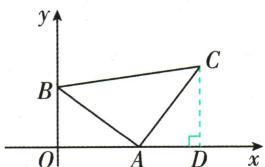

> [!success]- 必刷题
>
> > [!success] **【答案】** 详见解析
>
> > [!note]- **【解析】**
> > 【解】(1)在正方形ABCD与正方形CEFH中， $BC=DC, CH=CE, \angle BCD=\angle ECH=90^{\circ}$ 所以 $\angle BCD + \angle DCH = \angle ECH + \angle DCH$ 即 $\angle BCH = \angle DCE$ .
> > 在 $\triangle BCH$ 和 $\triangle DCE$ 中， $\left\{\begin{aligned}BC&=DC,\\ \angle BCH&=\angle DCE,\\ CH&=CE,\end{aligned}\right.$ 所以 $\triangle BCH\cong\triangle DCE(SAS)$ ，所以BH=DE.
> > (2)设 BH 与 CD 相交于点 O. 因为 $\triangle BCH\cong\triangle DCE$ ，所以 $\angle CBH = \angle CDE$ . 又因为 $\angle BOC = \angle DOM$ ，所以 $\angle DMB = \angle BCD = 90^{\circ}$ ，所以 $BH \perp DE$ .
> >
> > 大招解读 | 一线三等角模型(K型)三个相等的角在同一直线上,称为一线三等角模型(若相等的角为直角则可称为一线三垂直模型),利用三等角关系可找到三角形全等所需的角相等条件(如 $\angle1=\angle2$ ).
> >
> > $$
> > (1) \because A (4, 0), B (0, 3), \therefore O A = 4, O B =
> > $$
> >
> > $$
> > 3, \therefore O A \cdot O B = 4 \times 3 = 1 2.
> > $$
> >
> > $$
> > C D \perp x
> > $$
> >
> > $$
> > \angle A O B =
> > $$
> >
> > $$
> > \angle C D A = 9 0 ^ {\circ}, \therefore \angle A C D + \angle C A D = 9 0 ^ {\circ}
> > $$
> >
> > 
> >
> > $\because \angle BAC = 90^{\circ}, \therefore \angle CAD + \angle BAO = 90^{\circ},$ $\therefore \angle ACD = \angle BAO.$
> >
> > (2) 由 $\angle AOB = 90^{\circ}$ , AB = AC, $\angle BAC = 90^{\circ}$ , 想到作 $CD \perp x$ 轴于点 D, 构造一线三等角模型, 证得全等即可求解.
> >
> > 在 $\triangle BAO$ 和 $\triangle ACD$ 中， $\left\{\begin{aligned}\angle AOB&=\angle CDA=90^{\circ},\\\angle BAO&=\angle ACD,\\AB&=CA,\end{aligned}\right.$ ∴ $\triangle BAO \cong \triangle ACD(AAS), \therefore AD = OB = 3, CD = OA = 4, \therefore OD = OA + AD = 4 + 3 = 7, \therefore C(7, 4).$
