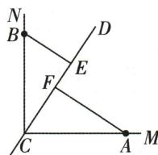
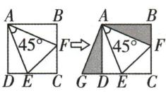
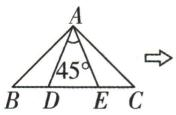
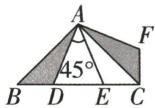
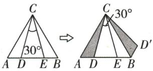

> [!success]- 必刷题
>
> > [!success] **【答案】** $\angle \alpha +\angle ACB = 180^{\circ}
>
> > [!note]- **【解析】**
> > 【解】(1)① $EF=|BE-AF|$ . 证明:如题图(1), 当E在F的左侧时,∵ $\angle BEC=\angle CFA=\angle\alpha=\angle BCA=90^{\circ}$ ,∴ $\angle BCE+\angle ACF=90^{\circ}$ , $\angle CBE+\angle BCE=90^{\circ}$ ,∴ $\angle CBE=\angle ACF$ . 在△BCE和
> > △CAF中, $\left\{\begin{aligned}\angle CBE&=\angle ACF,\\ \angle BEC&=\angle CFA,\\ BC&=CA,\end{aligned}\right.$ ∴ △BCE ≅ △CAF(AAS), ∴ BE = CF, CE = AF, ∴ EF = CF - CE = BE - AF. 如图, 当 E 在 F 的右侧时, 同理可证 EF = AF - BE, ∴ EF = |BE - AF|.
> >
> > 
> > - **②**：$\angle \alpha +\angle ACB = 180^{\circ}$ 时，①中的结论仍然成立.当 $E$ 在 $F$ 的左侧时， $\because \angle BEC = \angle CFA = \angle \alpha ,$ $\angle \alpha +\angle ACB = 180^{\circ},\therefore \angle CBE + \angle BCE = 180^{\circ}-$ $\angle \alpha ,\angle ACF + \angle BCE = 180^{\circ} - \angle \alpha ,$ $\therefore \angle CBE = \angle ACF.$ 在△BCE和△CAF中， $\left\{ \begin{array}{l}\angle CBE = \angle ACF,\\ \angle BEC = \angle CFA,\\ BC = CA, \end{array} \right.$ ∴ $\triangle BCE\cong \triangle CAF(AAS),\therefore BE = CF,CE = AF,$ ∴ $EF = CF - CE = BE - AF.$ 当 $E$ 在 $F$ 的右侧时，同理可证 $EF = AF - BE,\therefore EF = |BE - AF|$ .故答案为 $\angle \alpha +\angle ACB = 180^{\circ}.$ (2) $EF = BE + AF.$ 证明：
> > ∵∠BEC=∠CFA=∠α，∠α=∠BCA，∠EBC+∠BCE+∠BEC=180°，∠BCE+∠ACF+∠BCA=180°，∴∠EBC=∠ACF.
> > 在△BEC和△CFA中， $\left\{ \begin{array}{l}\angle EBC = \angle FCA,\\ \angle BEC = \angle CFA,\\ BC = CA, \end{array} \right.$ ∴△BEC≌△CFA（AAS），∴AF=CE，BE=CF，∴EF=CF+CE=BE+AF.
> >
> > ## 大招解读|半角模型
> >
> > 半角模型中的重要元素:(1)半角;(2)邻边相等. 半角模型中经常通过旋转将分散的条件集中起来, 进而通过证明两个三角形全等进行解题. 半角模型求解中一般涉及两次全等证明, 一次旋转型全等, 一次对称型全等.
> >
> > <table><tr><td>正方形含半角</td><td>等腰直角三角形含半角</td></tr><tr><td colspan="2">等边三角形含半角( $\angle ACB = 60^{\circ}$ )</td></tr></table>
