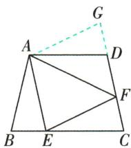
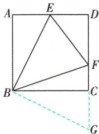

> [!success]- 必刷题
>
> > [!success] **【答案】** $EF=BE+DF$
>
> > [!note]- **【解析】**
> > 【解】(1)在 $\triangle ABE$ 和 $\triangle ADG$ 中, $\left\{\begin{aligned}BE&=DG,\\ \angle B&=\angle ADG,\\ AB&=AD,\end{aligned}\right.$ 所以 $\triangle ABE\cong\triangle ADG(SAS)$ ,所以 $AE=AG$ , $\angle BAE=\angle DAG$ .因为 $\angle BAD=120^{\circ},\angle EAF=$ $60^{\circ}$ ,所以 $\angle EAF=\frac{1}{2}\angle BAD$ ,所以 $\angle GAF=$ $\angle DAG+\angle DAF=\angle BAE+\angle DAF=\angle BAD-$ $\angle EAF=\angle EAF$ .在 $\triangle AEF$ 和 $\triangle AGF$ 中, $\left\{\begin{aligned}AE&=AG,\\ \angle EAF&=\angle GAF,\\ AF&=AF,\end{aligned}\right.$ 所以 $EF=FG$ .因为 $FG=DG+DF=BE+DF$ ,所
> > 以 $EF=BE+DF$ .故答案为 $EF=BE+DF$ .
> >
> > (2) 结论 $EF = BE + DF$ 仍然成立. 理由: 如图 (1), 延长 $FD$ 到点 $G$ , 使 $DG = BE$ , 连接 $AG$ . 因为 $\angle B + \angle CDA = 180^\circ$ , $\angle ADG + \angle CDA = 180^\circ$ , 所以 $\angle B = \angle ADG$ . 在 $\triangle ABE$ 和 $\triangle ADG$ 中, $\left\{ \begin{array}{l} BE = DG, \\ \angle B = \angle ADG, \\ AB = AD, \end{array} \right.$ 所以 $\triangle ABE \cong \triangle ADG(\text{SAS})$ , 所以 $AE = AG$ , $\angle BAE = \angle DAG$ . 因为 $\angle EAF = \frac{1}{2}\angle BAD$ , 所以 $\angle GAF = \angle DAG + \angle DAF = \angle BAE + \angle DAF = \angle BAD - \angle EAF = \angle EAF$ . 在 $\triangle AEF$ 和 $\triangle AGF$ 中, $\left\{ \begin{array}{l} AE = AG, \\ \angle EAF = \angle GAF, \\ AF = AF, \end{array} \right.$ 所以
> >
> > ## 思路分析
> >
> > (2) 延长 FD 到点 G，使 DG=BE，连接 AG，即可说明 $\triangle ABE \cong \triangle ADG$ ，可得 AE=AG，再说明 $\triangle AEF \cong \triangle AGF$ ，可得 EF=FG，即可解题.
> >
> > (3) 延长 DC 到 G, 使 CG = AE, 连接 BG, 根据“SAS”可判定 $\triangle AEB \cong \triangle CGB$ , 故可得出 BE = BG, $\angle ABE = \angle CBG$ , 从而推出 $\angle EBF = \angle GBF$ , 即可由“SAS”判定 $\triangle EBF \cong \triangle GBF$ , 得 EF = GF, 进而得出结果.
> >
> > $\triangle AEF \cong \triangle AGF$ (SAS), 所以 $EF = FG$ . 因为 $FG = DG + DF = BE + DF$ , 所以 $EF = BE + DF$ .
> >
> > 
> > 图(1)
> >
> > 
> > 图(2)
> > (3) $\triangle DEF$ 的周长是10.如图(2)，延长 $DC$ 到点 $G$ ，使 $CG = AE$ ，连接 $BG$ .因为四边形ABCD是正方形，所以 $\angle A = \angle ABC = \angle BCD = 90^{\circ}$ $AB = BC.$ 在 $\triangle AEB$ 与 $\triangle CGB$ 中， $\left\{ \begin{array}{l}AE = CG,\\ \angle A = \angle BCG,\\ AB = CB, \end{array} \right.$ 所以 $\triangle AEB\cong \triangle CGB(SAS)$ ，所以 $BE = BG,$ $\angle ABE = \angle CBG.$ 因为 $\angle EBF = 45^{\circ},\angle ABC =$ $90^{\circ}$ ，所以 $\angle ABE + \angle CBF = 45^{\circ}$ ，所以 $\angle CBF+$ $\angle CBG = 45^{\circ}$ ，所以 $\angle EBF = \angle GBF.$ 在 $\triangle EBF$ 与 $\triangle GBF$ 中， $\left\{ \begin{array}{l}BE = BG,\\ \angle EBF = \angle GBF,\\ BF = BF, \end{array} \right.$ 所以 $\triangle EBF\cong \triangle GBF(SAS)$ ，所以 $EF = GF$ ，所以 $\triangle DEF$ 的周长为 $EF + ED + DF = AE + CF+$ $ED + DF = AD + CD = 5 + 5 = 10.$
