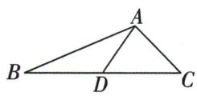
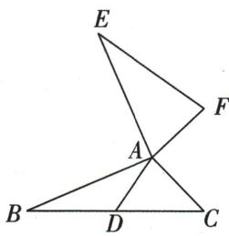

<!-- question-source:start -->
2[2025 江苏南京质检, 较难](1) 如图(1), 在 $\triangle ABC$ 中, $AB = 9$ , $AC = 5$ , 求 $BC$ 边上的中线 $AD$ 的取值范围.

(2) 如图(2), AD 是 $\triangle ABC$ 的中线, AB = AE, AC = AF, $\angle BAE = \angle FAC = 90^{\circ}$ , 试探究线段 AD 与 EF 的数量和位置关系, 并加以证明.

图(1)

图(2)
<!-- question-source:end -->

![[Q00104160A1]]
