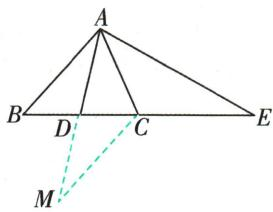

> [!success]- 必刷题
>
> > [!success] **【答案】** C
>
> > [!note]- **【解析】**
> > 【解】如图,延长AD至M,使DM=AD.
> >
> > 因为 AD 是 $\triangle ABC$ 的中线, 所以 BD = CD.
> > 在 $\triangle ABD$ 和 $\triangle MCD$ 中， $\left\{\begin{aligned}BD&=CD,\\ \angle ADB&=\angle MDC,\\ AD&=MD,\end{aligned}\right.$
> >
> > 
> >
> > 所以 $\triangle ABD \cong \triangle MCD$ (SAS), 所以 $MC = AB$ , $\angle B = \angle MCD$ . 因为 $AB = CE$ , 所以 $CM = CE$ . 因为 $\angle BAC = \angle BCA$ , 所以 $\angle B + \angle BAC = \angle ACB + \angle MCD$ , 即 $\angle ACE = \angle ACM$ . 在 $\triangle ACE$ 和 $\triangle ACM$ 中, $\left\{ \begin{array}{l} AC = AC, \\ \angle ACE = \angle ACM, \\ CE = CM, \end{array} \right.$ 所以 $\triangle ACE \cong \triangle ACM$ (SAS), 所以 $AE = AM$ . 因为 $AM = 2AD$ , 所以 $AE = 2AD$ .
