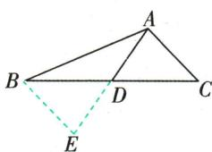
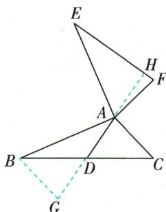

> [!success]- 必刷题
>
> > [!success] **【答案】** AB
>
> > [!note]- **【解析】**
> > 【解】(1)如图(1),延长AD到E,使得AD=DE,则AE=2AD.∵D是BC的中点,∴BD=CD.在△ACD和△EBD中, $\left\{\begin{aligned}CD&=BD,\\ \angle ADC&=\angle EDB,\\ AD&=DE,\end{aligned}\right.$ $\therefore \triangle ACD \cong \triangle EBD (SAS), \therefore BE = AC.$ 在 $\triangle ABE$ 中,由三角形的三边关系可得 AB-BE<AE<AB+BE,即 AB-BE<2AD<AB+BE.∵AB=9,AC=BE=5,∴9-5<2AD<9+5,∴2<AD<7,
> > ∴ BC 边上的中线 AD 的取值范围为 2<AD<7.
> >
> > 
> >
> > 思路分析
> > 由于AB与AD和BC之间没有什么直接的联系,所以必须通过作辅助线建立AB与AD和BC之间的联系,进而求解.可以在AB上截取AF=AD,连接EF,证明 $\triangle BCE\cong\triangle BFE;$ 也可延长BC至点F,使BF=AB,连接EF,证明 $\triangle ADE\cong\triangle FCE,$ 进而得出三条线段之间的关系.
> >
> > (2) $EF = 2AD$ 且 $EF \perp AD$ . 证明如下: 如图 (2), 延长 $AD$ 到 $G$ , 使得 $AD = DG$ , 延长 $DA$ 交 $EF$ 于点 $H$ . 同 (1) 可证 $\triangle ACD \cong \triangle GBD, \therefore AC = BG, \angle DAC = \angle DGB, \therefore \angle BAC = \angle BAD + \angle DAC = \angle BAD +$
> >
> > 
> > 图(2)
> >
> > $\angle DGB, \therefore \angle ABG + \angle BAD + \angle DGB = \angle ABG + \angle BAC = 180^{\circ}$ . $\because \angle BAE = \angle FAC = 90^{\circ}$ , $\therefore \angle EAF + \angle BAC = 180^{\circ}, \therefore \angle EAF = \angle ABG.$ $\because AC = AF, AC = BG, \therefore BG = AF.$ 在 $\triangle ABG$ 和 $\triangle EAF$ 中， $\left\{ \begin{array}{l} AB = AE, \\ \angle ABG = \angle EAF, \\ BG = AF, \end{array} \right.$ $\therefore \triangle ABG \cong \triangle EAF (\mathrm{SAS}), \therefore EF = AG, \angle HEA = \angle BAG.$
> >
> > $\because AG = 2AD, \therefore EF = 2AD. \because \angle BAE = 90^{\circ}, \therefore \angle EAH + \angle BAG = 90^{\circ}. \because \angle HEA = \angle BAG, \therefore \angle HEA + \angle EAH = 90^{\circ}, \therefore \angle AHE = 90^{\circ}, \therefore AD \perp EF.$ 综上所述， $EF = 2AD$ 且 $EF \perp AD.$
> >
> > 大招解读 | 截长补短法
> > “截长补短法”的具体做法: 在某一条线段上截取一条线段与特定线段相等, 或将某条线段延长, 使之与特定线段相等, 构造出全等三角形, 再利用全等三角形的有关性质解决问题. 当题目中出现线段和差关系的时候, 一般都可以用“截长补短法”求解.
