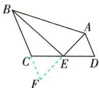
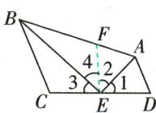

> [!success]- 必刷题
>
> > [!success] **【答案】** 详见解析
>
> > [!note]- **【解析】**
> > 【证明】补短法:如图(1),延长BC至点F,使BF=AB,连接EF.因为AD//BC,所以 $\angle CBA+\angle BAD=180^{\circ}$ .因为BE平分 $\angle CBA$ ,AE平分 $\angle BAD$ ,所以 $\angle ABE=\angle EBF$ , $\angle BAE=\angle DAE$ ,所以 $\angle EBA+\angle BAE=90^{\circ}$ ,所以 $\angle BEA=180^{\circ}-(\angle EBA+\angle BAE)=90^{\circ}$ .
> > 在 $\triangle ABE$ 和 $\triangle FBE$ 中, $\left\{\begin{aligned}AB&=FB,\\ \angle ABE&=\angle FBE,\\ BE&=BE,\end{aligned}\right.$ $\triangle ABE \cong \triangle FBE(SAS)$ ,所以 $\angle BEA = \angle BEF = 90^{\circ}, AE = FE$ ,所以A,E,F三点共线.因为AD//BC,所以 $\angle EAD=\angle F$ .
> > 在 $\triangle ADE$ 和 $\triangle FCE$ 中, $\left\{\begin{aligned}\angle EAD &= \angle F,\\ AE &= FE,\\ \angle AED &= \angle FEC,\end{aligned}\right.$ 所以 $\triangle ADE \cong \triangle FCE(ASA)$ ,所以AD=CF,所以 $AB=BC+CF=BC+AD.$
> >
> > 
> > 图(1)
> >
> > 
> > 图(2)
> >
> > 截长法:如图(2),在AB上截取AF=AD,连接EF.因为 $AD\parallel BC$ ,所以 $\angle ABC+\angle DAB=180^{\circ}$ .
> > 又因为BE平分 $\angle ABC,AE$ 平分 $\angle DAB$ ，所以 $\angle ABE=\angle EBC,\angle DAE=\angle FAE$ ，所以 $\angle ABE+$ $\angle EAB = \frac{1}{2} (\angle ABC + \angle DAB) = 90^\circ$ ，所以 $\angle AEB = 90^\circ$ ，即 $\angle 2 + \angle 4 = 90^\circ$ .
> > 在 $\triangle ADE$ 和 $\triangle AFE$ 中， $\left\{\begin{aligned}AD&=AF,\\ \angle DAE&=\angle FAE,\\ AE&=AE,\end{aligned}\right.$ 所以 $\triangle ADE \cong \triangle AFE(SAS)$ ，所以 $\angle 1 = \angle 2$ .
> > 又因为 $\angle 2 + \angle 4 = 90^\circ$ ，所以 $\angle 1 + \angle 3 = 90^\circ$ ，
> > 所以 $\angle 3 = \angle 4$ .
> >
> > 在 $\triangle BCE$ 和 $\triangle BFE$ 中， $\left\{\begin{aligned}\angle CBE&=\angle FBE,\\ BE&=BE,\\ \angle3&=\angle4,\end{aligned}\right.$ 所以 $\triangle BCE \cong \triangle BFE(ASA)$ ，所以 BC = BF，所以 $AB = BF + AF = BC + AD$ .
