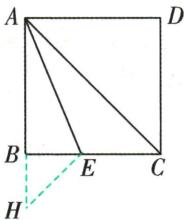
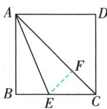

> [!success]- 必刷题
>
> > [!success] **【答案】** 详见解析
>
> > [!note]- **【解析】**
> > 【解】方法一:(补短法)如图(1),延长AB至H,使AH=AC,连接EH.因为AE平分∠BAC,所以∠HAE=∠CAE.
> > 在△AEH和△AEC中, $\left\{\begin{aligned}AH&=AC,\\ \angle HAE&=\angle CAE,\\ AE&=AE,\end{aligned}\right.$ 所以 $\triangle AEH \cong \triangle AEC$ (SAS), 所以 $\angle H = \angle ACE = 45^{\circ}$ . 又因为 $\angle EBH = 180^{\circ} - \angle ABE = 90^{\circ}$ , 所以 $\triangle HBE$ 是等腰直角三角形, 所以 BH = BE, 所以 $AB + BE = AB + BH = AH = AC$ .
> >
> > 截长法和补短法可以根据题目条件灵活应用.
> >
> > 
> >
> > 
> > 图(1)
> > 图(2)
> >
> > 方法二:(截长法)如图(2),在AC上截取AF=AB,连接EF.因为AE是∠BAC的平分线,所以∠BAE=∠FAB.
> > 在 $\triangle ABE$ 和 $\triangle AFE$ 中, $\left\{\begin{aligned}AB&=AF,\\ \angle BAE&=\angle FAE,\\ AE&=AE,\end{aligned}\right.$ 所以 $\triangle ABE\cong\triangle AFE(SAS)$ ,
> > 所以 BE=FE, $\angle ABE=\angle AFE=90^{\circ}$ .
> > 因为 $\angle ACE=45^{\circ}$ ，所以 $\triangle EFC$ 是等腰直角三角形，所以CF=EF=BE，所以 $AB+BE=AF+CF=AC$ .
> >
> > 归纳总结
> > 已知三角形的角平分线的交点到一边的距离及三角形的周长求面积时,一般利用角平分线的性质得三角形的角平分线的交点到三角形三边的距离相等,利用三角形的面积公式列式求解.本题中,O为三角形三条内角平分线的交点,一般结论为 $S_{\triangle ABC} = \frac{1}{2}(AB + BC + CA) \cdot OD.$
> >
> > ## 14.3 角的平分线
> >
> > ## 课时 1 角平分线的性质
