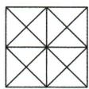
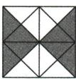
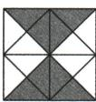
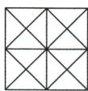
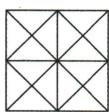
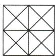

<!-- question-source:start -->
1[2025 浙江绍兴质检]如图(1),正方形被划分成16个全等的三角形,将其中若干个三角形涂黑,且满足下列条件:

(1) 涂黑部分的面积是原正方形面积的一半；
(2) 涂黑部分中存在全等图形.

如图(2)是一种涂法,请在图(4)、(5)、(6)中分别设计另外三种不同的涂法.(在所设计的图案中,若涂黑部分全等,则认为是同一种涂法,如图(2)与图(3))

图(1)
图(2)

图(3)

图(4)

图(5)
图(6)
<!-- question-source:end -->

![[Q00104181A1]]
