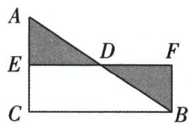
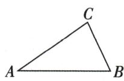

<!-- question-source:start -->
2[2025 贵州遵义期末]如图(1), Rt△ABC 中, ∠C=90°, D 是 AB 的中点, 过点 D 作 DE⊥AC 于点 E, 过点 B 作 BF⊥ED, 交 ED 的延长线于点 F.

(1) 求证: $\triangle DFB \cong \triangle DEA$ .

(2)某数学兴趣小组解答(1)后发现,在图中只需将 $\triangle AED$ 剪下来拼到 $\triangle BFD$ 处,就可得到一个与图(1)中 $\triangle ABC$ 等面积的长方形EFBC.继续讨论后又发现,任意三角形也可以剪拼成一个等面积的长方形,请你在图(2)中画出一种剪拼示意图,并简要说明作法(不需要证明).

图(1)

图(2)
<!-- question-source:end -->

![[Q00104182A1]]
