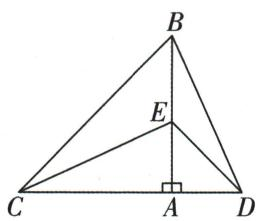
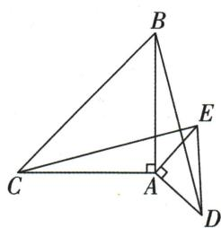

<!-- question-source:start -->
3[2025 广东肇庆质检] 小明和小华各买了一副大小不同的三角板. 小明把他们两人的等腰直角三角板的直角的顶点和一直角边叠在一起拼成如图(1)的图形( $\triangle ABC$ 和 $\triangle ADE$ ), $\angle BAC = \angle DAE = 90^{\circ}$ , AB = AC, AD = AE, 连接 BD, CE.

(1) 求证: $BD = CE$ .

(2) 小华把小明的拼图动了一下, 但两块三角板的直角顶点还是叠在一起的, 如图(2), 请问 $BD$ 和 $CE$ 还相等吗? 证明你的结论.

(3)请分别指出两个拼图中, $BD$ 与 $CE$ 的位置关系,不用说明理由.

图(1)

图(2)

是个新“烤”鸭
<!-- question-source:end -->

![[Q00104183A1]]
