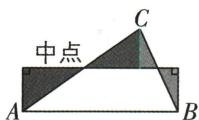
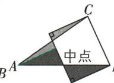
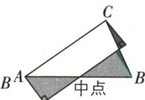
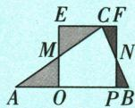

> [!success]- 必刷题
>
> > [!success] **【答案】** (1)
>
> > [!note]- **【解析】**
> > 【证明】∵ $DE \perp AC, BF \perp ED, D$ 是 AB 的中点，∴ $\angle AED = \angle BFD = 90^{\circ}, AD = BD.$ ∵ $\angle ADE = \angle BDF, \therefore \triangle DFB \cong \triangle DEA.$ (2)【解】(画出一种即可, 答案不唯一, 给出以下三种作法供参考)如图.
> >
> > 
> > - **①**：
> > - **②**：
> > - **③**：(2) 如图, 分别过 AC, BC 的中点 M, N 作 AB 的垂线, 垂足分别为 O, P, 再过点 C 作 AB 的平行线, 与 OM, PN 的延长线交于点 E, F, 则长方形 OPFE 的面积与 $\triangle ABC$ 的面积相等.
> >
> > 作法①: 找 AC, BC 的中点, 过两中点作一条直线, 分别过点 A, B 作该直线的垂线, 得到的以 AB 为边的长方形与 $\triangle ABC$ 的面积相等.
> > 作法②: 找 AC, AB 的中点, 过两中点作一条直线, 分别过点 B, C 作该直线的垂线, 得到的以 BC 为边的长方形与 $\triangle ABC$ 的面积相等.
> > 作法③: 找 AB, BC 的中点, 过两中点作一条直线, 分别过点 A, C 作该直线的垂线, 得到的以 AC 为边的长方形与 $\triangle ABC$ 的面积相等.
> >
> > 
