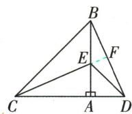
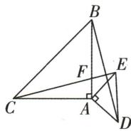

> [!success]- 必刷题
>
> > [!success] **【答案】** (1)
>
> > [!note]- **【解析】**
> > 【证明】在 $\triangle ABD$ 与 $\triangle ACE$ 中， $\left\{\begin{aligned}AB&=AC,\\ \angle BAD&=\angle CAE=90^{\circ},\\ AD&=AE,\end{aligned}\right.$ ∴ $\triangle ABD \cong \triangle ACE(SAS)$ , ∴ BD = CE.
> >
> > (2)【解】BD=CE. 证明：∵ $\angle BAC = \angle DAE = 90^{\circ}$ ，∴ $\angle BAC + \angle BAE = \angle DAE + \angle BAE$ ，即 $\angle CAE = \angle BAD$ 。在 $\triangle ABD$ 与 $\triangle ACE$ 中， $\left\{\begin{aligned}&AB=AC,\\&\angle BAD=\angle CAE,\therefore\triangle ABD\cong\triangle ACE(SAS),\\&AD=AE,\end{aligned}\right.$ $\therefore BD=CE.$
> >
> > 思路分析
> > (2) 先证明 $\angle BAD = \angle CAE$ ,
> > 再根据 SAS
> > 证明 $\triangle ABD \cong \triangle ACE$ ，可得
> > 答案.
> >
> > (3)【解】两个拼图中, BD 与 CE 的位置关系均为互相垂直. 如图(1), 延长 CE 交 BD 于 F. ∵ $\triangle ABD \cong \triangle ACE, \therefore \angle ADB = \angle AEC.$ ∵ $\angle ABD + \angle ADB = 90^{\circ}, \angle AEC = \angle BEF, \therefore \angle ABD + \angle BEF = 90^{\circ}, \therefore CE \perp BD.$ 如图(2), 设 AB 与 CE 交于 F. ∵ $\triangle ABD \cong \triangle ACE, \therefore \angle ACE = \angle ABD.$ ∵ $\angle ACF + \angle AFC = 90^{\circ}, \angle AFC = \angle BFE, \therefore \angle ABD + \angle BFE = 90^{\circ}, \therefore CE \perp BD.$
> >
> > 
> >
> > 
> > 图(1)
> > 图(2)
> >
> > ## 全章综合训练
