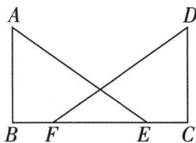

<!-- question-source:start -->
3[2025 浙江杭州期中]如图,在 $\triangle ABE$ 和 $\triangle DCF$ 中, $\angle B=\angle C,AB=DC$ ,若要利用 SAS 证明 $\triangle ABE \cong$ △DCF,还需要添加一个条件: \_\_\_\_.（只填一个即可）

建议用时-15分钟
<!-- question-source:end -->

![[Q00104104A1]]
