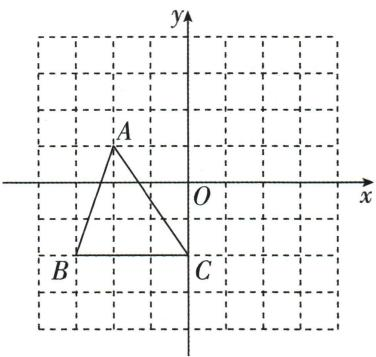

<!-- question-source:start -->
4[2025 安徽淮北质检]如图,在平面直角坐标系中, $\triangle ABC$ 的顶点都在网格线的交点上,请利用无刻度的直尺画出 $\triangle AB_{1}C$ ,使得 $\triangle ABC$ 与 $\triangle AB_{1}C$ 全等.

<!-- question-source:end -->

![[Q00104105A1]]
