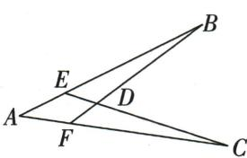
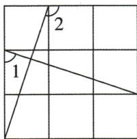

<!-- question-source:start -->
5 如图, 点 E 在 AB 上, 点 F 在 AC 上, 且 AE = AF, AB = AC, BF = 5, DE = 1, 则 DC 的长为 ( )
A. 1    B. 2    C. 3    D. 4

(第 5 题图)

(第6题图)
<!-- question-source:end -->

![[Q00104106A1]]
