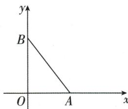

<!-- question-source:start -->
7[2025 贵州毕节期中]如图,在平面直角坐标系中, $A(3,0)$ , $B(0,4)$ ,连接AB,在平面直角坐标系中找一点C(点C不在坐标

轴上),使 $\triangle AOC$ 与 $\triangle AOB$ 全等,则C点的坐标为\_\_\_\_.
<!-- question-source:end -->

![[Q00104108A1]]
