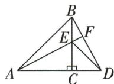

<!-- question-source:start -->
8[2024 广东江门校级期中]如图, $\triangle ACB$ 和 $\triangle ECD$ 都是等腰直角三角形, $A, C, D$ 三点在同一直线上, 连接 $BD, AE$ , 延长 $AE$ 交 $BD$ 于 $F$ .

(1) 求证: $AE = BD$ .

(2)试判断直线 $AE$ 与 $BD$ 的位置关系,并说明理由.

<!-- question-source:end -->

![[Q00104109A1]]
