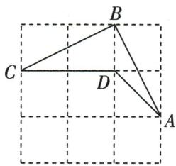
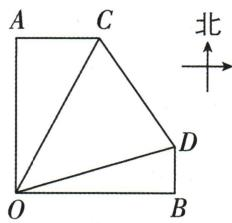

<!-- question-source:start -->
1 新考法 [2025 四川成都期中, 中] 如图是由 9 个完全相同的小正方形拼接而成的 $3 \times 3$ 网格, 图形 $ABCD$ 中各个顶点均为格点, 设 $\angle ABC = \alpha$ , $\angle BCD = \beta$ , $\angle BAD = \gamma$ , 则 $\alpha - \beta - \gamma$ 的值为 ( )
A. $45^{\circ}$ B. $60^{\circ}$ C. $75^{\circ}$ D. $135^{\circ}$

(第1题图)

(第2题图)
<!-- question-source:end -->

![[Q00104110A1]]
