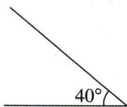
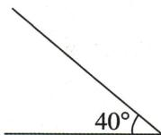

<!-- question-source:start -->
4 [2024 北京西城区校级期中, 中]已知一个三角形的两条边长分别是 1 cm 和 2 cm, 一个内角为 40°.
(1)请你借助如图所示图形画出一个满足题中条件的三角形.
(2)你是否还能画出既满足题中条件,又与(1)中所画三角形不全等的三角形?若能,请你用尺规画出一个这样的三角形;若不能,请说明理由.(友情提醒:请在你画的图中标出已知角的度数和已知边的长度.不要求写作法,保留

作图痕迹)

(3)如果将题中条件改为“三角形的两条边长分别是3 cm和4 cm,一个内角为40°”,那么满足这一条件,且彼此不全等的三角形共有\_\_\_\_个.

备用图
<!-- question-source:end -->

![[Q00104113A1]]
