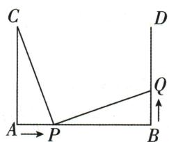
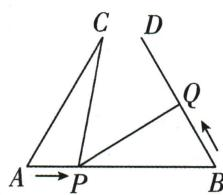

<!-- question-source:start -->
5 核心素养 模型观念 [中] 如图(1), $AB = 4 \mathrm{~cm}, AC \perp AB, BD \perp AB, AC = BD = 3 \mathrm{~cm}$ . 点 $P$ 在线段 $AB$ 上以 $1 \mathrm{~cm} / \mathrm{s}$ 的速度由点 $A$ 向点 $B$ 运动, 同时, 点 $Q$ 在线段 $BD$ 上由点 $B$ 向点 $D$ 运动, 设它们运动的时间为 $t \mathrm{~s}$ .

(1) 若点 $Q$ 的运动速度与点 $P$ 的运动速度相同, 当 $t = 1$ 时, $\triangle ACP$ 与 $\triangle BPQ$ 是否全等? 请说明理由, 并判断此时线段 $PC$ 和线段 $PQ$ 的位置关系.

(2)如图(2),将图(1)中的“ $AC \perp AB, BD \perp AB$ ”改为“ $\angle CAB = \angle DBA = 60^{\circ}$ ”,其他条件不变.设点Q的运动速度为x cm/s,是否存在实数x,使得 $\triangle ACP$ 与 $\triangle BPQ$ 全等?若存在,求出相应的x,t的值;若不存在,请说明理由.

图(1)

图(2)

沉迷刷题
无法自拔
<!-- question-source:end -->

![[Q00104114A1]]
