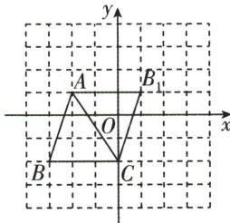
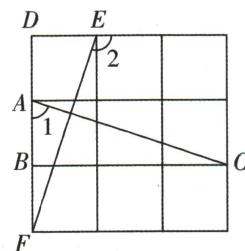

> [!success]- 必刷题
>
> > [!success] **【答案】** 详见解析
>
> > [!note]- **【解析】**
> > 【解】如图, $\triangle AB_{1}C$ 即为所求.
> > ∵ $AB_{1} \parallel BC$ , ∴ $\angle ACB = \angle CAB_{1}$ . ∵ AC = AC,
> > BC= $AB_{1}$ , ∴ $\triangle ABC \cong \triangle CB_{1}A(SAS)$ .
> >
> > 
> >
> > 
> > (第4题图)
> > (第6题图)
