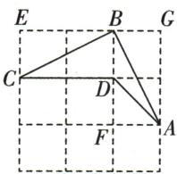
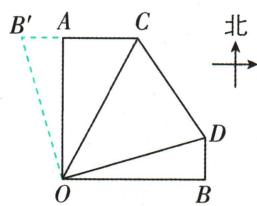

> [!success]- 必刷题
>
> > [!success] **【答案】** A
>
> > [!note]- **【解析】**
> > 如图, 根据题意知, $BE = AG$ , $\angle BEC = \angle AGB = 90^\circ$ , $EC = GB$ , $\therefore \triangle BEC \cong \triangle AGB(SAS)$ , $\therefore \angle ECB = \angle GBA$ . $\because \angle ECB + \angle EBC = 90^\circ$ , $\therefore \angle GBA + \angle EBC = 90^\circ$ , $\therefore \angle ABC = 90^\circ = \alpha$ . $\because \angle BCD + \angle CBD = \beta + \angle CBD = 90^\circ$ , $\angle CBD + \angle ABD = 90^\circ$ , $\therefore \angle ABD = \beta$ . $\because \angle ADF = \angle ABD + \angle BAD = 45^\circ$ , $\therefore \beta + \gamma = 45^\circ$ , $\therefore \alpha - \beta - \gamma = \alpha - (\beta + \gamma) = 90^\circ - 45^\circ = 45^\circ$ , 故选 A.
> >
> > 
> > (第1题图)
> >
> > 
> > (第2题图)
