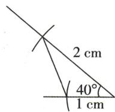
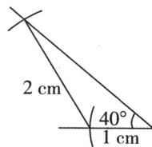
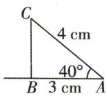
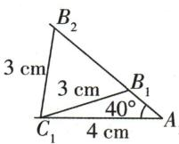
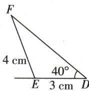

> [!success]- 必刷题
>
> > [!success] **【答案】** 4
>
> > [!note]- **【解析】**
> > 【解】(1)在 $40^{\circ}$ 角的两边上分别以顶点为圆心截取1 cm和2 cm长的线段,连接得到的两个线段端点即可得到符合条件的三角形,如图(1)所示.(作法不唯一)
> >
> > 
> > 图(1)
> >
> > 
> > 图(2)
> >
> > (2)能.如图(2)所示的三角形即为所求.(作法不唯一,与(1)中图形不全等即可)
> > (3)当40°角是边长为3cm与4cm两边的夹角时,△ABC如图(3)所示;
> >
> > 
> > 图(3)
> >
> > 
> > 图(4)
> >
> > 
> > 图(5)
> >
> > 当 $40^{\circ}$ 角是 $3\mathrm{cm}$ 边的对角时， $\triangle A_{1}B_{1}C_{1}$ 及 $\triangle A_{1}B_{2}C_{1}$ 如图(4)所示；当 $40^{\circ}$ 角是 $4\mathrm{cm}$ 边的对角时， $\triangle DEF$ 如图(5)所示.综上，共有4个这样的三角形满足条件.故答案为4.
> >
> > ## 刷素养·
