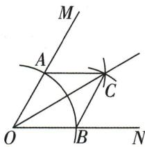

<!-- question-source:start -->
1[2025 吉林长春期末]如图,以点 O 为圆心,适当长为半径作弧,交 OM 于点 A,交 ON 于点 B,分别以点 A,B 为圆心,大于 $\frac{1}{2}AB$ 的长为半径作弧,两弧在 $\angle MON$ 的内部相交于点 C,作射线 OC.

(1)根据以上尺规作图的过程可得到结论:射线 OC 为 $\angle MON$ 的 \_\_\_\_.

(2) 连接 AC, BC, 运用三角形全等的相关判定方法证明(1)中的结论.

<!-- question-source:end -->

![[Q00104163A1]]
