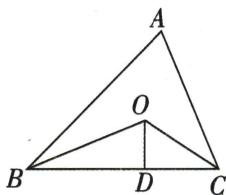

<!-- question-source:start -->
4 如图, 已知 $\triangle ABC$ 的周长是 34, BO, CO 分别平分 $\angle ABC$ 和 $\angle ACB, OD \perp BC$ 于 D, 且 OD = 4, 则 $\triangle ABC$ 的面积是 ( )

A. 17 B. 34 C. 38 D. 68

建议用时 20 分钟 答案 D29
<!-- question-source:end -->

![[Q00104166A1]]
