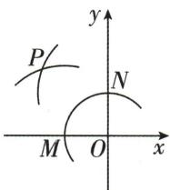
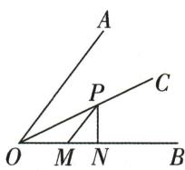

<!-- question-source:start -->
5[2025 湖北恩施州校级期中]如图,在平面直角坐标系中,以 O 为圆心,适当长为半径作弧,交 x 轴负半轴于点 M,交 y 轴正半轴于点 N,分别以点 M,N 为圆心,大于 $\frac{1}{2}MN$ 的长为半径作弧,两弧在第二象限交于点 P. 若点 P 的坐标为 (a, b),则 a 与 b 的数量关系为 ( )
A. a=b    B. a-b=1
C. a+b=-1    D. a+b=0

(第5题图)
(第6题图)
<!-- question-source:end -->

![[Q00104167A1]]
