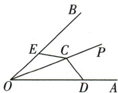

<!-- question-source:start -->
7[2025 河南洛阳期中]如图, 已知 $\angle AOB = \alpha$ , 点 C 在 $\angle AOB$ 的平分线 OP 上, $\angle DCE = 180^{\circ} - \alpha$ , 且 $\angle DCE$ 的两边分别与 OA, OB 交于点 D 和点 E, 求证: CD = CE.

<!-- question-source:end -->

![[Q00104169A1]]
