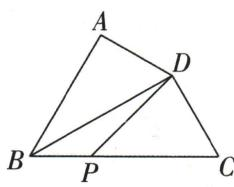
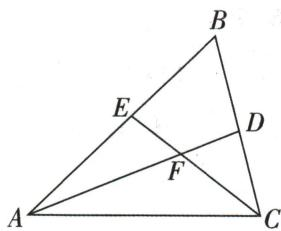

<!-- question-source:start -->
1[2024 浙江温州校级质检, 中]如图, 在四边形 $ABCD$ 中, $\angle A = 90^{\circ}, AD = 4$ , 连接 $BD, BD \perp CD$ , $\angle ADB = \angle C$ . 若 $P$ 是 $BC$ 边上一动点, 则 $DP$ 长的最小值为 ( )
A. 3 B. 4 C. 5 D. 6

(第1题图)

(第2题图)
<!-- question-source:end -->

![[Q00104170A1]]
